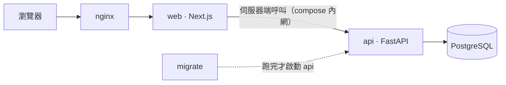

# Project Starter

FastAPI + Next.js 全端起始模板，開箱即有認證、角色權限、中英雙語與 migration。
以**模組化**與**可測試**為優先：功能切成模組，模組邊界由測試強制執行。

## Quickstart

需要 Docker Desktop、`make`、`openssl`、`uv` 與 Node（版本見 [`apps/web/.nvmrc`](apps/web/.nvmrc)）。

```bash
make init dev   # 產生 .env（MODE=development，金鑰自動產生）並安裝相依
make start      # 啟動開發環境（首次建置約 2–5 分鐘）
```

## 包含什麼

| | |
|---|---|
| 後端 | FastAPI、SQLAlchemy 2.0 async、Alembic、Python 3.14；pytest、ruff、mypy |
| 前端 | Next.js 16、React 19、TypeScript、CSS Modules；Vitest、ESLint、knip |
| 基礎設施 | PostgreSQL 17、Docker Compose（dev／prod）、nginx、GitHub Actions |
| 功能 | JWT 認證、角色權限、使用者與角色管理、Session 撤銷、登入限流、游標分頁 |
| 前後端契約 | 後端產生 OpenAPI → 前端型別，端點、權限、語系寫錯都是編譯錯誤 |
| i18n | 前後端一致的中英雙語，漏翻譯會編譯失敗 |

## 架構

```text
app（組裝層） → modules（垂直功能） → shared（平台能力）
```

- **每個功能是一個模組**，前後端同名，各自擁有路由、資料表、權限、畫面與測試。
- **跨模組只走 public entry**，由 import-linter（後端）與 dependency-cruiser（前端）強制執行。
- **測試與原始碼同構**：`tests/modules/users/` 對 `modules/users/`。



瀏覽器只認得 nginx，碰不到 api。

## 文件

| | |
|---|---|
| [`AGENTS.md`](AGENTS.md) | 給 AI agent 的規則與陷阱 |
| [`docs/architecture.md`](docs/architecture.md) | 依賴規則、模組介面、目錄結構、前後端契約 |
| [`docs/development.md`](docs/development.md) | 指令、測試策略、程式碼風格、CI |
| [`docs/features.md`](docs/features.md) | 內建功能怎麼運作：帳號、角色、Session、密碼、限流、語系 |
| [`docs/extending.md`](docs/extending.md) | 開新案時的擴充項目：新增模組、權限、migration、語系 |
| [`docs/operations.md`](docs/operations.md) | 部署、主機設定、備份與救援 |

## 開新專案時

1. 複製這份目錄，`make init dev` 會順便 `git init`。
2. 改寫這份 README、[`LICENSE`](LICENSE) 與 `.env.example` 的 `COMPOSE_PROJECT_NAME` 預設值。
3. 照 [`docs/development.md`](docs/development.md#開發流程) 的 checklist 設定 GitHub 一次
   （squash merge、`main` 的 ruleset、Dependabot 警示與安全更新）。
4. 在 `apps/web/app/theme.css` 覆寫設計變數決定視覺（名字與預設值在 `shared/ui/styles/tokens.css`）。
5. 照 [`docs/extending.md`](docs/extending.md#新增一個功能模組) 加入第一個模組。
